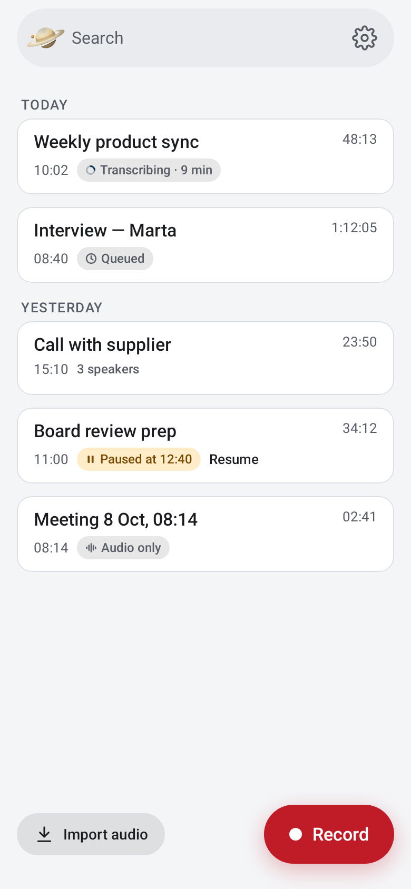
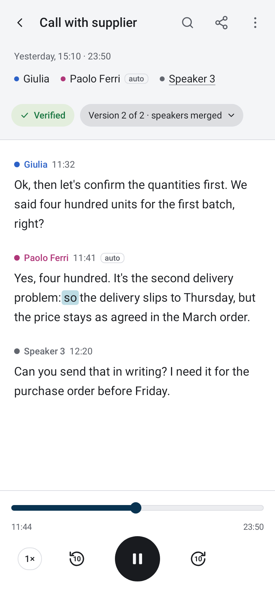
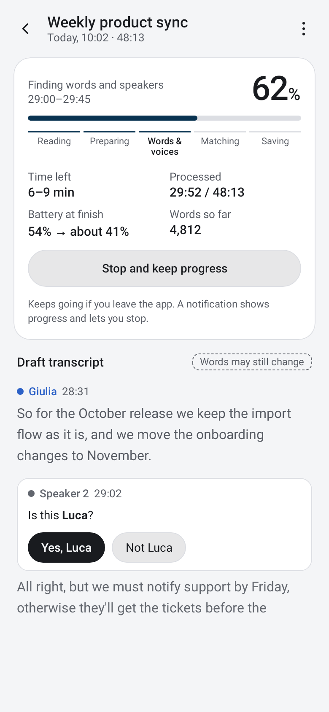
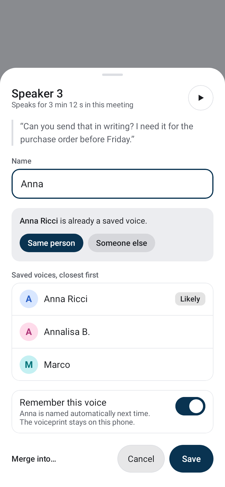
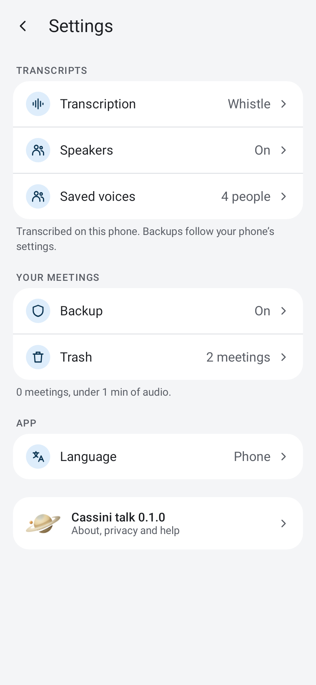
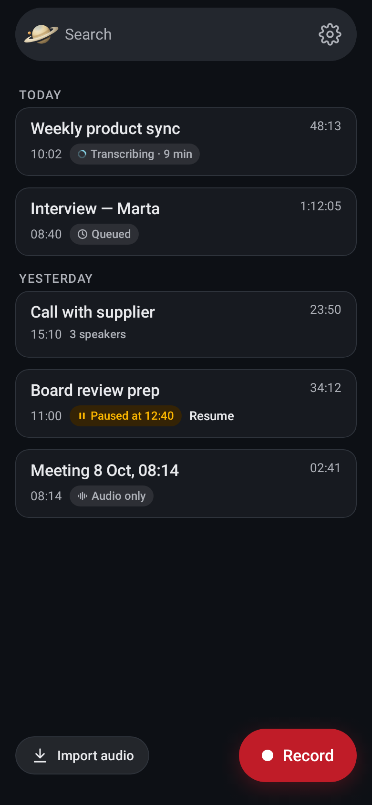
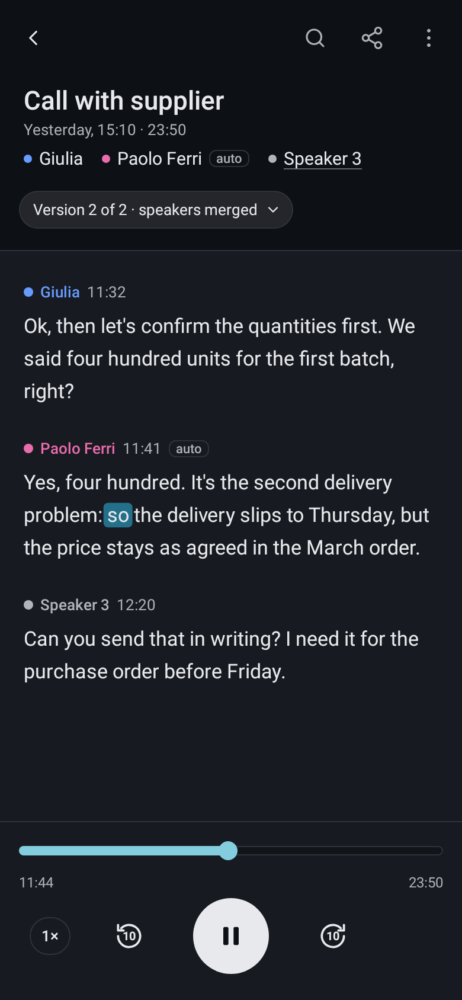
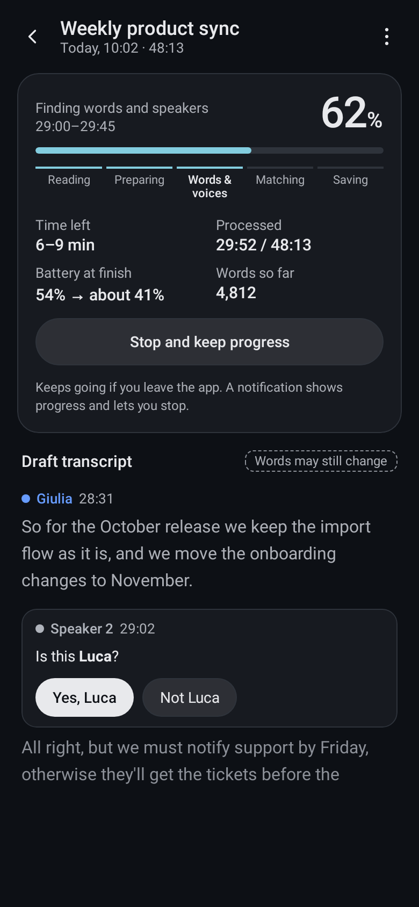
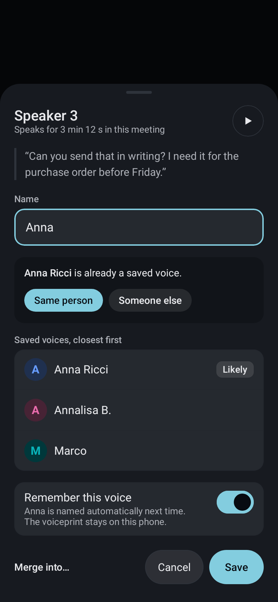
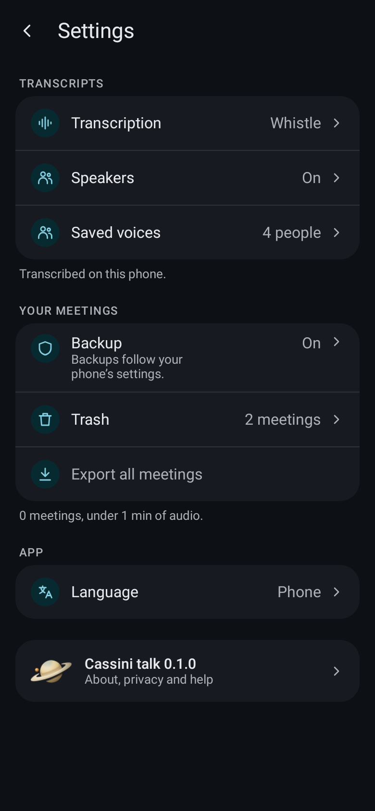

# Cassini talk for Android

Cassini records audio and makes the transcript on your phone. It labels the speakers and can remember the voices of the people that you name. It keeps the audio and the timed words together in one `.opus` file. Any audio player plays this file, and other Cassini software reads the transcript in it. On compatible arm64 phones with Android 10 or later, Whistle is included and is the initial default: basic transcription needs no model download or network connection. Once Parakeet is installed and verified, new transcriptions default to it; you can still choose Whistle. Parakeet is a recommended download from `dist.gocassini.com`, and remains the default on other devices. The Parakeet model is [Parakeet Ultra](https://huggingface.co/moondream/parakeet-ultra) by Moondream, a further-trained NVIDIA Parakeet TDT 0.6B v3 for 25 European languages.

**[Download the latest release](https://github.com/codemyriad/cassini-android/releases/latest)** · [Changelog](CHANGELOG.md)

## Privacy

Cassini does all speech recognition and speaker analysis on the phone. It does not upload audio, transcripts or voiceprints. It has no accounts, no analytics and no advertising. The app uses the network only to download the models, and only after you agree. Voiceprints stay in the private storage of the app. Android can copy notes, the catalogue and saved voices in two ways, which you can turn off in Settings: encrypted cloud backup (Google or Seedvault, on by default) and, on Android 9 or later, direct device-to-device transfer to a new phone (on by default). Cassini itself uploads nothing, and downloaded models and unfinished work are never copied. Cassini never writes a voiceprint into a document or an export. [`PRIVACY.md`](PRIVACY.md) gives the full privacy policy.

## Requirements

- Android 8.0 (API 26) or later, on a 64-bit ARM phone (`arm64-v8a`). The APK also has `x86_64` for emulators.
- Included Whistle requires Android 10 or later and an arm64 CPU with dot-product support. Settings shows when it is unavailable.
- The optional Parakeet, speaker and voice models need about 1.3 GB free while installing and about 0.8 GB afterwards. Their total download is about 530 MB.
- 4 GB of RAM is a good start. This is not a tested minimum.

## Screenshots

These screenshots are the phone goldens of the `:ui` screenshot tests ([`docs/development.md`](docs/development.md#screenshot-tests)). CI compares them with the current screens on every change, so they show the current design. They use test data and test names.

| | Notes | Read and listen | Transcribing | Name a speaker | Settings |
|---|---|---|---|---|---|
| Light |  |  |  |  |  |
| Dark |  |  |  |  |  |

## Build

```sh
git clone --recurse-submodules https://github.com/codemyriad/cassini-android
cd cassini-android
./scripts/setup.sh
./gradlew :app:assembleDebug
```

The build needs JDK 17 and the Android SDK. [`CONTRIBUTING.md`](CONTRIBUTING.md) gives the tools, the tests and the rules for a change.

## Modules

```
:core       Pure Kotlin/JVM. The verbatim engine plus pure app rules (statuses, search,
            trash arithmetic, exports, speaker stats, model plan).
:app-logic  Pure Kotlin/JVM app policies (leaf state, import tracking, model-install
            ownership and sequencing).
:data       Android library. Room catalogue, DataStore settings, file repositories.
:engine     Android library. Native wrappers (sherpa-onnx, Whistle, libcassini_opus),
            MediaCodec decoder, microphone capture, TranscriptionJob, ProgressTracker.
:ui         Android library. Compose design system and stateless screens.
:app        Android application. AppGraph, ViewModels, navigation, services, notifications.
:bench      Experiments and calibration on a device (com.android.test). Never in CI.
:baselineprofile  Generates the Baseline Profile of :app on a device. Never in CI.

app -> ui
app -> app-logic -> core
data, engine -> app-logic
app -> data -> core
app -> engine -> core
bench, baselineprofile -(instrument)-> app
```

`whistle/` holds the build and verification tools of the included Whistle runtime ([`whistle/README.md`](whistle/README.md)). `tools/` holds host programs that Gradle does not build.

## Documentation

- [`CONTRIBUTING.md`](CONTRIBUTING.md): build, tests, style and pull requests. Coding agents also read [`AGENTS.md`](AGENTS.md).
- [`docs/README.md`](docs/README.md): the index of every document, with the guides, the reference, the design specifications and the dated records.
- [`docs/development.md`](docs/development.md): worktrees, test tiers, device scripts and the pre-release gate.
- [`docs/architecture.md`](docs/architecture.md): modules, storage, background work and the build.
- [`docs/data-formats.md`](docs/data-formats.md): storage layout, the portable document, exports and the differences from gocassini.
- [`docs/native-runtime.md`](docs/native-runtime.md): the sherpa-onnx AAR and libopus.
- [`docs/release.md`](docs/release.md): tags, signing and the F-Droid draft.
- [`scripts/README.md`](scripts/README.md): the helper scripts, grouped by task.
- [`SECURITY.md`](SECURITY.md), [`PRIVACY.md`](PRIVACY.md), [`CODE_OF_CONDUCT.md`](CODE_OF_CONDUCT.md) and [`CHANGELOG.md`](CHANGELOG.md).

The [cassini-format](https://github.com/codemyriad/cassini-format) repository gives the specification of the portable format. The desktop pipeline and the web viewer are in [gocassini](https://github.com/codemyriad/gocassini).

## License

Cassini for Android is free software under the [GPLv3](LICENSE). [`THIRD_PARTY_NOTICES.md`](THIRD_PARTY_NOTICES.md) gives the licenses and sources of the dependencies and the models. We developed Cassini with AI coding assistance.
